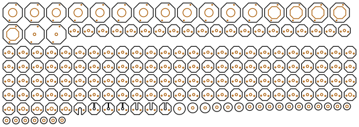

# Practice chanters

**[← All projects](https://gernreich.github.io/)**

<!-- readme-only -->
**[Read the writeup](https://gernreich.github.io/practice-chanters/)** ·
**[Turn them in 3D](https://gernreich.github.io/practice-chanters/)**

<!-- page-only **[Read the README](https://github.com/Gernreich/practice-chanters)** · **[Turn them in 3D on a page of their own](turn.html)** -->

<!-- page-only <iframe src="turn.html?embed" title="A practice chanter as solid plates you can drag to turn and pull apart: a long stack of thin polygonal plates with darker finger-hole plates along the front, a wider cap at one end and a round mouthpiece beyond it, with a button for the stacked octagon and the two standard strip chanters" style="width:100%;height:560px;border:0"></iframe> -->

A Great Highland bagpipe practice chanter in 3 mm plywood with an octagonal bore:
[the stacked octagon](#the-stacked-octagon), a stack of thin cross-section plates with
the bore cut through every one, clamped on two threaded rods, under a stacked cap and
mouthpiece; its holes are a real practice chanter's, where that chanter's are. Three more are built differently, from long strips glued round the bore:
[the strip chanter](#the-strip-chanter), whose holes come from the model,
[the standard strip chanter](#the-standard-strip-chanter), whose holes are a real
practice chanter's, and [the standard octagon](#the-standard-octagon), the same holes
as slots in eight strips round an octagonal bore. Besides threaded rod, nuts and
pins, the only part you buy is a plastic practice-chanter reed.

Output is millimetre-true — `1 user unit = 1mm` with a physical `width`/`height` — so
it prints and cuts at real size.

**None has been cut or played yet.** Three of the four copy a measured chanter's holes and
use an acoustic model, not yet checked against a real chanter, for the difference; the strip
chanter's holes come from the model alone. The reed's length inside the cap is a guess.
[Before you cut](#before-you-cut) says what that costs, and [Tuning](#tuning) how to
take it up.

<table>
<tr>
<td align="center"><a href="cut-files/practice-chanter-8-sided-sheet1-cut-files.svg"></a></td>
</tr>
<tr>
<td align="center"><sub>the stacked octagon: every plate on one sheet</sub></td>
</tr>
</table>

Built for **[LaserMadeMusic](https://www.youtube.com/@LaserMadeMusic)**.

**[The rest of the build files](https://gernreich.github.io/lasermademusic.html)** — every instrument,
generator and tool, indexed.

**[Download everything as a ZIP](https://github.com/Gernreich/practice-chanters/archive/refs/heads/main.zip)**

## Why an octagon

**Stacked plates take any polygon.** What a bore's cross-section needs is the right
area. Its shape matters far less:
[a square-bored chanter](https://www.daye1.com/bagpage/makepipe/squint1.html)
was built on exactly that principle, a square of the round bore's area at every point.
Here the bore is the area of [the measured practice chanter's](#the-standard-strip-chanter)
4.87 mm round bore, 18.63mm².
A plate is a slice across the chanter, so the polygon is simply cut out of it.

Until 2026-10-23 there were six stacked chanters, triangle to octagon, all of which
built and tuned in the model. Only the octagon is kept:

- **Its bore is all but round.** Each face is 1.96 mm wide, where a triangle's of the same
  area would be 6.56 mm and a square's 4.32 mm, and the laser's own kerf rounds its corners.
- **It has the least wall.** For the same area it has 3% more wall than a round bore,
  against 13% for the square and 29% for the triangle. More wall means more friction
  losses, and so duller, less responsive notes.

The model still takes any number of sides from three to eight:
`python3 chanter_model.py --sides=5` solves the pentagon's holes.

**There is a cut-off if the bore is built the other way**, from long strips jointed
round it as the [octagonal flute](https://github.com/Gernreich/octagonal-flute) is.
Each strip is a face of the bore, and its finger joints need ply between them. In
3 mm ply at a 4 mm bore, **only the square works.** The pentagon leaves 1.36 mm between
joints where 3 mm is needed. The hexagon and up leave less, and the octagon none.
The triangle cannot be finger-jointed at all, since its corners are too sharp for
the joint. Thinner 1.5 mm stock buys the pentagon. A wider bore would buy more shapes, but
then it is no longer a practice chanter. That is why this one is a stack.

## The stacked octagon

Its holes are [the measured practice chanter's](#the-standard-strip-chanter), as the two
standard chanters' are: each where the reference's is, measured from the reed's seat, and
sized in the model to sound the reference's note there. Until 2026-10-23 the model placed
and sized them on its own, round a 4 mm bore inside a 20 mm outside, and gave a body 396 mm
long, half as long again as the real chanter's. Its bore was a third smaller than the
reference's and its wall thicker.

| | |
|---|---|
| Pitch | the reference's, every note sounding where the reference's does in the model |
| Scale | low G to high A, the [Highland scale](https://en.wikipedia.org/wiki/Great_Highland_bagpipe) |
| Fingering | the [standard Highland fingering](https://bagpipejourney.com/articles/finger_positions.shtml): seven finger holes on the front, the high A thumb hole on the back |
| Bore | an octagon 4.74 mm across its flats, the area of the reference's 4.87 mm round bore, 237 mm long, open at the sole |
| Body | 16 mm across the flats outside, a 5.6 mm wall where the reference's tapers from 7.4 to 5.1 mm; 264 mm long, 88 plates |
| Seat | nine plates with the reference's 5.57 mm seat, 27 mm deep (the reference's 25.5) |
| Cap | 19 plates: a socket over the body and a 13 mm chamber round the reed; then a 24-plate mouthpiece tapered as the reference's is |
| Joints | clamped on two M2 threaded rods; the cap press-fit on 2 mm pins; the mouthpiece glued; the seams sealed with shellac |
| Model | every note the reference's, low G 6.7 cents sharp |
| Sheet | one 595 × 132 mm sheet of 3 mm ply, 131 parts |

| Hole | Under the seat | Slot | As a round hole | The reference |
|---|---|---|---|---|
| low A | 196.5 mm | 4.31 mm | 4.06 mm | 4.15 mm |
| B | 163.5 mm | 3.60 mm | 3.71 mm | 3.95 mm |
| C | 139.5 mm | 4.37 mm | 4.09 mm | 3.95 mm |
| D | 112.5 mm | 3.37 mm | 3.59 mm | 3.95 mm |
| E | 88.5 mm | 3.98 mm | 3.90 mm | 3.95 mm |
| F | 64.5 mm | 3.42 mm | 3.61 mm | 3.35 mm |
| high G | 43.5 mm | 2.73 mm | 3.23 mm | 3.05 mm |
| high A, the thumb's | 31.5 mm | 2.62 mm | 3.16 mm | 2.95 mm |

**A hole is a slot across one plate,** 3 mm tall and as wide as its note needs, from the
bore out through the face. The model takes it as the round hole of its area. Each sits
in the plate the reference's hole centre falls in, so it is up to 1.5 mm from the
reference's, 1.0 mm at the most here. A slot under 1 mm wide would be too narrow to cut
cleanly and would be drilled instead, at a V cut in its plate's edge; at 3 mm ply none is.

**The outside is as thin as the rods allow.** Each plate carries two M2 rods, which need
1.5 mm of ply round them, clear of the bore, the seat and any slot, and room for a washer
on the end plates. At 15.5 mm across the flats they would have less. A thicker wall wants
bigger holes: at 17 mm low A would need a slot wider than 5 mm, more than a finger pad
closes. 16 mm is between the two, and the reference's own outside, about 20 mm at low A and
15 mm at high A, spans it.

**The staple is held by its hemp,** as on the reference. The bore under the seat is wider
than the smallest staple, so nothing stops one but the hemp wrapped round it.

Low G sounds from the whole bore, and the bore is a whole number of plates, so it lands
6.7 cents sharp: a plate less would be 21 cents sharp, a plate more 8 flat. The generator
prints how far.

## The strip chanter

The second design builds the square bore from four long strips of 3 mm ply, front, back
and two sides, glued round it. The strips run from the sole to just above the high A
hole. Above that the chanter is stacked plates, the cookies, up to the reed's seat.

| | |
|---|---|
| Bore | 3.54 mm square in the strips, 4 mm round in the cookies: the same area, so no note moves |
| Strips | 259.5 mm long, 9.54 mm square outside; finger-jointed (`--joint=finger`, the default) or butt-jointed (`--joint=butt`) |
| Cookies | 54 plates, 20 mm square: 5 glued over the strips' top, 43 with the round bore, 6 for the seat; clamped on two M2 rods 169 mm long |
| Where it changes | 244 mm up the 406.5 mm body, 0.60 of the way; high A's centre 10.0 mm under the cookies |
| Holes | round, laser-cut in the strips, 1.02 to 3.09 mm across; the thumb's in the back strip |
| Model | every note within 1.0 cents, low G too, since the strips can be any length |
| Sheet | one 599 × 157 mm sheet, 101 parts |

**Finger joints do work.** The strips are 3 mm thick round a 3.54 mm bore. At each corner
one strip has a finger 3 mm deep and its neighbour a notch. Each strip has fingers along
one edge or the other in turn, so it is seldom only its 3.54 mm middle. Round each hole
its own strip has fingers along both edges, 1.5 mm past the hole, so the ply beside a hole
is never a notch. The strip across from it then has none, for 4 to 10 mm: the back strip
opposite each front hole, and the front opposite the thumb's. Glued into the square,
those stretches are held on all four sides.
The fingers also line the strips up as they go together, which butt joints leave to you.
With `--joint=butt` the front and back are 9.54 mm wide and the sides 3.54 mm, glued
between them.

**Why the holes are small.** The holes are spaced for the hands, 27 mm apart in each hand,
but the scale's steps are not equal, so each hole is whatever size puts its note in tune
where it stands. A hole for a small step, such as D or G, comes out small. The largest is
limited by the bore: a hole wider than the bore's 3.54 mm face would cut into the side
strips, so 3.2 mm is the most. The hand's layout is set by C and E, which are solved at
2.5 mm and pull every other hole along with them. The wall's thickness matters little:
with an 8 mm wall the holes are within 0.4 mm of these. It does matter for G. F to high G
is the scale's smallest step, so G must sit 16 mm above F instead of 21 mm. Any further
and high G would be sharp even at a 1 mm hole.

**The thumb has room.** The cookies stand 5 mm proud of the strips. The high A hole's
centre is 10.0 mm below that shoulder, so the thumb can seal it. Pass `--switch=0.8` to
put the change 4/5 of the way up instead.

**The staple stops on its hemp.** The round bore under the seat is 4 mm, the size of the
smallest staple, so a 4 mm staple could slide on into it. A larger one stops on the bore.

**What is glued.** The strips to each other, and the strips into the cookies' socket.
The cookies are clamped on rods, and the cap press-fits as on the stacked octagon.

Building it:

1. Cut the sheet. Dry-fit the four strips first: each strip's two edges have different
   finger patterns, so it goes in only one way.
2. Glue the strips round a length of 3.5 mm rod or a waxed drill bit, to keep glue out of
   the bore. Clamp lightly and wipe off any glue that squeezes out.
3. Thread the cookies onto the two rods, from the seat down to the socket, with a nut
   and washer at the seat end. Brush shellac on each face as it goes on.
4. Glue the strips' top 15 mm into the socket. Put the bottom washers and nuts on and
   tighten them. Cut the rods flush with the top nuts.
5. Seal the bore with shellac on a pipe cleaner, and fit the cap and reed as on the
   stacked octagon.

## The standard strip chanter

This one takes its holes from a real practice chanter: [aero1016's model of the
practice chanter they own](https://www.thingiverse.com/thing:6658761), measured from
its 3D file. That chanter has a 4.87 mm round bore, 238.5 mm from the sole to the reed's
seat, its front holes 25 mm apart from B up to F and low A 32 mm below B, and a collar 10 mm under the seat that the top rests on.

| | |
|---|---|
| Bore | 5.5 mm square, from the sole into the collar |
| Strips | 236.3 mm long, 11.5 mm square outside, finger-jointed (`--joint=butt` for butt joints), glued |
| Foot | two layers of four strips lying flat round the strips' bottom, each cut to a 50 mm circle: 19.25 mm wide mid-face, shorter to the corners; 6 mm tall. The reference's foot is 25.4 mm round and 19 mm tall, so this one is wider and lower |
| Band | three 10 mm strips glued round the strips' front and sides, under the collar; none on the back, and each side piece's lower back corner cut away along a 10 mm quarter circle up to the collar, so there is no hard edge beside the thumb |
| Collar | one 25.4 mm round plate the strips' top stands in, wide enough to cover the band's corners, then two 22.2 mm round plates with the reference's 4.87 mm bore; the cap rests on them, flush |
| Tenon | 9 round plates 17 mm across with the reference's 5.57 mm reed seat; the cap slides over them. The 4.87 mm bore under the seat is wider than any staple, as on the reference, so the staple is held by its hemp, not stopped by a step |
| Cap | the reference's: a plain tube 22.2 mm round with a 17.6 mm bore, 123 mm long (the reference's 122), 40 rings and a closed top plate, glued, no pins; then the tapered mouthpiece, 24 plates |
| Jig | a 60 mm square base and two rings with a 50.3 mm hole, pinned into a cup, to glue the foot up in; not part of the chanter |
| Sheet | one 586 × 175 mm sheet, 95 parts with the jig |

| Hole | Under the seat | This chanter | The reference |
|---|---|---|---|
| low A | 195.5 mm | 3.33 mm | 4.15 mm |
| B | 163.5 mm | 3.43 mm | 3.95 mm |
| C | 138.5 mm | 3.64 mm | 3.95 mm |
| D | 113.5 mm | 3.83 mm | 3.95 mm |
| E | 88.5 mm | 4.06 mm | 3.95 mm |
| F | 63.5 mm | 3.54 mm | 3.35 mm |
| high G | 43.1 mm | 3.30 mm | 3.05 mm |
| high A, the thumb's | 31.1 mm | 3.22 mm | 2.95 mm |

**Every hole is where the reference's is,** measured from the reed's seat, which is
what the notes depend on. The sizes differ because a hole here goes through a 3 mm strip,
where the reference's walls are 5 to 7 mm. A hole through a thinner wall sounds sharper,
so it has to be smaller for the same note. A 4.5 mm bore, the smallest that takes the
reference's 4.15 mm hole, would need holes of 2.5 to 3.2 mm. The 5.5 mm bore is the size
at which they come back to the reference's, 3.2 to 4.1 mm. Each is solved so its note
sounds where the reference's does, in the model, and the bore is 3.8 mm longer at the sole
to bring low G there too.

**The model is used only for the difference,** not the pitch. It cannot reproduce the
reference's own scale: at the reed allowance that fits best, 130 mm, it is still about
40 cents out across the scale, low A at about 255Hz. So it is asked only how far the
square bore and the thin wall move each note from where the reference's is, and it
plays at whatever pitch the reference plays. The reference's maker had not yet printed
it, so that pitch is the real chanter's they measured, not one anyone has checked on
the print.

**That difference depends on how the reed is modelled.** The holes hardly move with
the reed allowance's length: at 100 mm or 160 mm instead of 130 mm, low A's hole changes
by 0.1 mm and the others by less. They do move with where it is put. Here the 130 mm is
taken as more of the square bore, as long as the reference's allowance. Taken instead
as the reference's own 4.87 mm round bore above the square, low G would want the bore
288 mm long, not 242 mm. Neither is measured, so the first one built and played settles
it; expect to [tune](#tuning) it.

**Shellac barely moves the pitch.** Dipping the chanter four times in 3 to 5 lb cut
leaves perhaps 50 to 100µm of shellac on each surface. That is an estimate, not a
measurement: the first coat soaks into the ply, and the film depends on the cut and
how it drains. It narrows the bore from 5.5 mm to between 5.4 and 5.3 mm, and every hole
by the same 0.1 to 0.2 mm. In the model that flattens the notes by 1 to 3 cents, the
high notes most. Watch for shellac pooling in the bore's corners and bridging the
finger holes: blow through the chanter after each dip, and clear each hole with a
toothpick. The seat narrows the same way, to about 5.4 mm, still over the largest staple.

**High A has room.** The thumb reaches up past its hole, so the band leaves the back
bare. The side pieces of the band are cut away along a quarter circle where they meet the
back, so they slope up to the collar rather than ending square beside the thumb.
Nothing stands proud of the back strip until the collar, 22.1 mm above the hole's
centre. On the reference chanter, its collar is 20.6 mm above.

Cut the sheet, and glue the strips as in the strip chanter's first two steps, round a
5.5 mm rod or waxed drill bit. Then:

1. Press the jig's base and two rings together on two 2 mm pins, and line the cup with
   packing tape or wax so the glue cannot stick to it. Stand the chanter in it on its
   sole. Glue the foot's layers in round the strips one at a time, the circle centring
   each. Each piece runs round one corner of the circle to the inner corner beyond.
   Each layer turns the other way from the one below, so no seam runs through.
2. Glue the band round the strips' top 10 mm: the wide piece across the front, the two
   narrow ones on the sides, flush with the back, their curved corners at the back
   and down, away from the collar.
3. Press the collar's two round plates and the tenon together on two 2 mm pins, and
   cut the pins flush with the collar's bottom face.
4. Glue the strips' top 3 mm into the collar's socket plate, and the collar's round
   plates onto it. The pins' ends land on the strips' top corners, inside the socket
   plate.
5. Glue the cap's 40 rings and its top plate together, top plate last. Lay them in
   the inside corner of two straight boards while the glue sets, which lines up their
   outsides. Then glue the mouthpiece on as for the other chanters.
6. Seal the chanter by dipping it four times in 3 to 5 lb cut shellac, as above. After
   each dip blow through the bore and clear each hole with a toothpick. Brush the
   inside of the cap.
7. Push the reed's staple into the seat. Wrap the tenon with hemp or tape until the
   cap slides on snugly and rests on the collar.

## The standard octagon

The standard strip chanter's holes on eight strips instead of four: the same measured
chanter, its holes where that chanter's are, on an octagonal bore. An octagon's faces
are narrow, so the holes are slots along the strips.

| | |
|---|---|
| Bore | an octagon 8 mm across its flats, from the sole into the collar: 56.1mm², three times the reference's 4.87 mm round |
| Strips | eight, 235.7 mm long, 14 mm across the flats outside, 5.8 mm wide, finger-jointed, glued |
| Holes | slots 2.8 mm across and 6.9 to 10.5 mm long; the thumb's in the back strip |
| Foot | two 50 mm round plates with the octagon through them, glued flush with the sole |
| Collar, tenon, cap, mouthpiece | the standard strip chanter's, but the collar's socket plate is 22.2 mm, flush with the cap, and there is no band |
| Sheet | one 599 × 158 mm sheet, 87 parts |

| Hole | Under the seat | Slot | As a round hole | The reference |
|---|---|---|---|---|
| low A | 195.5 mm | 7.2 × 2.8 mm | 4.86 mm | 4.15 mm |
| B | 163.5 mm | 7.6 × 2.8 mm | 4.98 mm | 3.95 mm |
| C | 138.5 mm | 8.5 × 2.8 mm | 5.29 mm | 3.95 mm |
| D | 113.5 mm | 9.3 × 2.8 mm | 5.56 mm | 3.95 mm |
| E | 88.5 mm | 10.5 × 2.8 mm | 5.95 mm | 3.95 mm |
| F | 63.5 mm | 8.1 × 2.8 mm | 5.18 mm | 3.35 mm |
| high G | 43.1 mm | 7.2 × 2.8 mm | 4.84 mm | 3.05 mm |
| high A, the thumb's | 31.1 mm | 6.9 × 2.8 mm | 4.74 mm | 2.95 mm |

**Why slots.** Each strip is 5.8 mm wide outside but only 3.3 mm inside, and a hole needs
1.5 mm of ply each side, so nothing wider than 2.8 mm fits. The notes want holes of 4.7 to
6 mm, so each is a slot of that hole's area, as long as it needs, up to 12 mm, which a
finger pad still covers. The model treats a slot as the round hole of its area, as it
does the stacked octagon's slots. A bigger octagon does not help: its holes grow faster
than its faces. A 12 mm octagon would need slots about 4.5 mm across and up to 17 mm long.
Nor can it be smaller, nearer the reference's bore: below 8 mm the strip opposite each slot,
which owns neither corner there, is under 1.5 mm wide (1.35 mm at 7.5 mm, 0.31 mm at 5 mm), and
the collar's pins no longer land on the strips' top.

**The joints.** The strips meet at 135°. Where a strip owns a corner it runs out to it;
where its neighbour does, it stops 2.12 mm short, square to its face. Each strip owns one
of its two corners at a time, in turn, so most of its length is 3.7 mm wide outside.
Round each slot its own strip owns both corners, 1.5 mm past the slot. Eight strips
round eight corners can't all keep one each there, so the strip opposite owns neither,
and is 1.56 mm wide for the slot's length: the back strip opposite each finger hole, and
the front opposite the thumb's, 97 mm in all. Once glued, those stretches are held on both
edges. Every corner also leaves a small groove along the bore, a 0.88 mm right
triangle, and the bore's area counts all eight.

**The model's question is bigger here.** The bore is three times the reference's area,
where the square's is 1.6 times, so the model is asked for a bigger difference. It also
depends on how the reed is modelled. Like the square, the octagon takes the reed's 130 mm
allowance as more of its own bore. Taken instead as the reference's round bore above
it, low G would want the octagon 328 mm long, not 242 mm, and the square 288 mm. Neither is
measured, so treat this chanter as the more experimental of the two and expect to
[tune](#tuning) it.

Building it:

1. Cut the sheet. Dry-fit the eight strips round a waxed 7.5 mm dowel or drill bit. Each
   strip's two edges have different finger patterns, so it goes in only one way. The
   front strip carries the seven finger slots and the back strip the thumb's.
2. Glue the strips round the dowel. Hold them with tape or rubber bands while the glue
   sets, and wipe off any that squeezes into the bore.
3. Press the collar's two round plates and the tenon together on two 2 mm pins, and cut
   the pins flush with the collar's bottom face.
4. Glue the strips' top 3 mm into the collar's socket plate, and the collar's round
   plates onto it. The pins' ends land on the strips' top.
5. Slide the two foot plates on from the sole and glue them flush with it, on a flat
   board.
6. Glue the cap's 40 rings and its top plate together, top plate last, in the inside
   corner of two straight boards. Then glue the mouthpiece on as for the other chanters.
7. Seal the chanter by dipping it four times in 3 to 5 lb cut shellac, as for the
   standard strip chanter. After each dip blow through the bore, so the shellac fills
   the corner grooves without pooling, and clear each slot. Brush the inside of the cap.
8. Push the reed's staple into the seat. Wrap the tenon with hemp or tape until the cap
   slides on snugly and rests on the collar.

## How it is built

The stacked octagon, from the top down:

- **The mouthpiece**, 24 round plates with a 4.5 mm blowing hole, shaped as the
  measured practice chanter's top piece is: a 45° shoulder off the cap, a step to
  16.5 mm, a step to 14.3 mm, then a long taper from 12.4 to 11.0 mm and a rounded lip.
  It is 72 mm long, the reference's 71.5 mm. Each plate is cut to the reference's
  diameter at its own mid-height, so the long taper goes down in steps of under 0.1 mm. The
  plates are too narrow for pins, so they are glued, lined up on a rod through the
  blowing hole.
- **The cap**: two top plates, twelve plates round a 13 mm chamber for the reed's
  blades, and five plates whose hole is the body's own octagon, 0.3 mm larger, to
  slide over the top of the body. It is the body's shape grown 6.3 mm outward, pressed
  together on two pins in its corners.
- **The seat**: nine plates with the reference's 5.57 mm round seat for the reed's
  staple. Practice-chanter staples run 4 to 4.8 mm across, and the 4.74 mm bore below
  stops only the largest, so the staple is held by its hemp, as on the reference.
- **The bore**: one plate for every 3 mm, the octagon through each, down to the open
  sole. Eight of them carry the finger holes.

Every body plate has the same two rod holes, placed so that turning or flipping the
plate puts them somewhere else: a plate threads on only one way, so no slot can end
up facing the wrong way. The rods are clamped by a nut and washer at each end. A
pin pressed through 88 plates would never go in, and nothing is glued. The cap is
not on the rods, since it comes off to set the reed. It slides over the top five
plates of the body and rests on the two top nuts.

## Turn them in 3D

<!-- readme-only -->
The chanters turn in 3D at the top of the [published page](https://gernreich.github.io/practice-chanters/),
which GitHub does not run: drag to turn them, pull them apart along their length,
and switch between the standard, the standard octagon and the stacked octagon.

<!-- page-only The 3D view is at [the top of this page](#practice-chanters): drag to turn a chanter, pull it apart along its length, and switch between the standard, the standard octagon and the stacked octagon. It also opens [on a page of its own](turn.html). -->

## Before you cut

**Measure the ply.** The stack multiplies the stock's error by every plate in it. 2.9 mm ply
makes the stacked octagon's bore 8 mm short, and every note 12 to 44 cents sharp in the
model, low G most. Measure a few places on the sheet with calipers, then pass the
average as `--plate=`. The generator re-solves every hole on that grid, and the plate
count follows.

**The reed's length is a guess.** The model treats the reed and staple as extra closed
bore: 130 mm on the stacked octagon and the two standard chanters, the figure that best fits
the measured chanter, and 20 mm on the strip chanter. Neither is a measured figure. A reed pushed deeper into its seat
plays sharper, and one pulled out plays flatter. That is how every practice chanter is
pitched, and it shifts the whole scale together, but it cannot fix one note against
another. `strip_chanter.py --reed=` sets the strip chanter's figure if you measure your own.

**The model does not match a real chanter.** It is a transfer-matrix model with textbook
tone-hole and end corrections. Given the measured chanter that the
[standard strip chanter](#the-standard-strip-chanter) copies, it cannot reproduce that
chanter's scale at any reed allowance. The closest, at 130 mm, is still about 40 cents
out, and at the 20 mm the strip chanter was designed with, the reference's scale comes
out stretched by hundreds of cents. So the strip chanter may play well out of tune, with
the upper notes sharpest, until a real chanter has been played and the model fitted to
it. The stacked octagon and the two standard chanters avoid most of this by copying a
real chanter and using the model only for the difference. For the strip chanter, expect
to do the [Tuning](#tuning) in earnest.

**The slots are cut exactly to width,** so a kerf other than the default 0.13 mm
changes every hole. Pass yours with `--kerf=`.

## Building it

You need two lengths of M2 threaded rod, four M2 nuts and washers, a few centimetres
of 2 mm brass rod for the pins, high-cut shellac, and a plastic practice-chanter reed.

1. Cut the sheet. The generator prints the stacking order: 9 seat, 10 bore, hA,
   3 bore, G, 6 bore, F, 7 bore, E, 7 bore, D, 8 bore, C, 7 bore, B, 10 bore, A,
   13 bore. Here "seat" and "bore" are runs of the
   plain plates, and the letters are the hole plates.
2. Cut the rods to the length the generator prints: 271 mm. Put a nut and washer on one end of each.
3. Thread the plates on from the sole up, in the reverse of that order. Brush thin
   shellac on each face as it goes on. The slots all face the same way because the
   rods only let them.
4. Put the top washers and nuts on and tighten them evenly, just enough to close every
   seam. Cut the rods off flush with the top nuts, or the cap will rest on the rods
   instead of the nuts. Let the shellac dry.
5. If the generator printed a hole to drill (at 3 mm ply there is none), drill it at its
   V mark, starting a size under the printed figure. Then seal the bore: draw a pipe cleaner wet with shellac through it a few
   times, and let it dry. Brush the inside of the cap the same way.
6. Press the cap's plates together on two pins through its corners. Stack the
   mouthpiece's plates, widest first, on a 4.5 mm drill shank pushed down through the
   cap's top, gluing each one, and pull the shank out before the glue sets. Sand the
   steps of the long taper smooth if you like.
7. Push the reed's staple into the seat. Wrap it with hemp if it is loose. Put the cap
   on.

## Tuning

Tune low A first, by moving the reed in or out of its seat. Then go up the scale:

- **A note that is flat** wants its hole bigger. File the slot wider a little at a
  time, or open the drill up a size.
- **A note that is sharp** wants its hole smaller. Line part of the slot with tape,
  or with a sliver of veneer and shellac.
- **Low G** has no hole. Tape across part of the open sole flattens it.

Widening a hole moves its own note most, about 10 cents for a fifth wider in the
model. The notes either side of it move a cent or two, so go up the scale once,
then check every note again and touch up.

## Regenerating it

```sh
python3 practice_chanters.py --no-write                   # the stacked octagon's checks, writing nothing
python3 practice_chanters.py --out=cut-files              # its sheet
python3 practice_chanters.py --plate=2.9 --no-write       # for ply as measured
python3 practice_chanters.py --kerf=0.18 --out=mine       # for a laser with a 0.18mm kerf
python3 strip_chanter.py --out=cut-files                   # the strip chanter, finger-jointed
python3 strip_chanter.py --joint=butt --out=cut-files      # the strip chanter, butt-jointed
python3 standard_chanter.py --out=cut-files                # the standard strip chanter
python3 standard_chanter.py --joint=butt --out=cut-files   # the same, butt-jointed
python3 standard_octagon.py --out=cut-files                # the standard octagon
python3 practice_chanters.py --page-to=turn.html           # the 3D view, every design
python3 chanter_model.py --sides=8                         # the acoustic model alone, any of 3 to 8 sides
```

`practice_chanters.py` draws nothing until every check passes:

- every note is the reference's in the model, and low G is as near as whole plates allow;
- the bore is the reference's area;
- every hole is where the reference's is, to the plate;
- the bore is whole plates, down to the sole;
- every finger hole is in its own plate, at its centre;
- every hole is cuttable or drillable;
- every slot runs the width it is tuned for;
- every rod and pin keeps ply between it and every cut;
- the nuts sit on the end plates, inside the body;
- every body plate goes on only one way;
- the seat takes any staple, held by its hemp as the reference's is;
- the cap slides over the body and stops on its nuts;
- every sheet fits the bed;
- no two parts on a sheet come closer than the gap;
- every part is on a sheet.

`practice_chanters.py` imports the kerf and the `Part` class from the square flute's
`square_flute.py`, the mitred offset from the four-hole ocarinas' `four_hole_ocarinas.py`,
the path writer from swept-curve and the 3D page from lasermade-tools. So
[square-flute](https://github.com/Gernreich/square-flute),
[four-hole-ocarinas](https://github.com/Gernreich/four-hole-ocarinas),
[swept-curve](https://github.com/Gernreich/swept-curve) and
[lasermade-tools](https://github.com/Gernreich/lasermade-tools) must be checked out
beside this repository.

One more is optional: with [bore-tmm](https://github.com/Gernreich/bore-tmm) checked out beside it too and built (`cargo build --release`), each model (`chanter_model.py`, `standard_chanter.py`) searches for each note in bore-tmm's Rust port of it, which gives the same results bit for bit, much sooner. Without it the Python runs, as it always did.

## Files

Every chanter is one sheet of 3 mm ply.

| | |
|---|---|
| `cut-files/practice-chanter-8-sided-sheet1-cut-files.svg` | the stacked octagon, every plate |
| `cut-files/practice-chanter-strips-finger-joint-sheet1-cut-files.svg` | the strip chanter, finger-jointed: strips, cookies, cap |
| `cut-files/practice-chanter-strips-butt-joint-sheet1-cut-files.svg` | the strip chanter, butt-jointed |
| `cut-files/practice-chanter-standard-strips-finger-joint-sheet1-cut-files.svg` | the standard strip chanter, finger-jointed: strips, foot, band, collar, tenon, cap, and the foot jig |
| `cut-files/practice-chanter-standard-strips-butt-joint-sheet1-cut-files.svg` | the standard strip chanter, butt-jointed |
| `cut-files/practice-chanter-standard-octagon-sheet1-cut-files.svg` | the standard octagon: eight strips, foot, collar, tenon, cap |
| `previews/practice-chanter-8-sided-sheet1-cut-files.svg` · `previews/practice-chanter-strips-finger-joint-sheet1-cut-files.svg` · `previews/practice-chanter-strips-butt-joint-sheet1-cut-files.svg` · `previews/practice-chanter-standard-strips-finger-joint-sheet1-cut-files.svg` · `previews/practice-chanter-standard-strips-butt-joint-sheet1-cut-files.svg` · `previews/practice-chanter-standard-octagon-sheet1-cut-files.svg` | a display rendering of each sheet — **not** cut files |
| `turn.html` | the 3D view, every design, on a page of its own |
| `practice_chanters.py` | the stacked octagon's generator, its checks, and the 3D view |
| `strip_chanter.py` | the strip chanter's generator and its checks |
| `standard_chanter.py` | the standard strip chanter's generator: the measured chanter, the hole sizes, its checks |
| `standard_octagon.py` | the standard octagon's generator: the slots, the joints, its checks |
| `chanter_model.py` | the acoustic model: where each hole goes and how wide |
| `README.md` · `index.html` | this writeup and its published page; the markdown is the source |
| `.repro` | the command that draws each generated file |
| `.doc-audit-links` | the one link the link check may find refusing scripts: Thingiverse answers them all 403 |

Released under [CC0 1.0](LICENSE).

## Credits

Made by Michael Gernreich with [Claude](https://www.anthropic.com/claude) (Anthropic), working in Claude Code, which co-wrote the code and the documentation. Commits Claude made carry a `Co-Authored-By: Claude` line.
