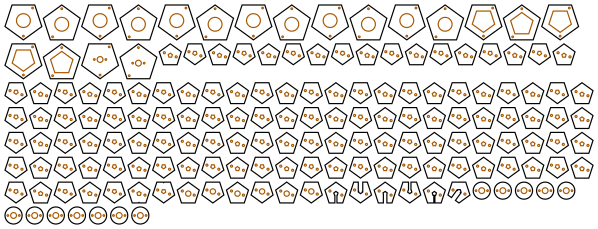

# Practice chanters

<!-- readme-only -->
**[Read the writeup](https://gernreich.github.io/practice-chanters/)** ·
**[Turn them in 3D](https://gernreich.github.io/practice-chanters/#turn-them-in-3d)**

<!-- page-only **[Read the README](https://github.com/Gernreich/practice-chanters)** -->

Six Great Highland bagpipe practice chanters in 3mm plywood, alike except for their
bores. One has a triangular bore, the others square, pentagonal, hexagonal, heptagonal and octagonal.
A seventh is built differently, below: [the strip chanter](#the-strip-chanter), a square bore of four
long strips with the plates only above the high A hole.
Each is a stack of thin cross-section plates with the bore cut through every one, clamped
on two threaded rods, under a stacked cap and mouthpiece. The only part you buy is a
plastic practice-chanter reed.

Output is millimetre-true — `1 user unit = 1mm` with a physical `width`/`height` — so
it prints and cuts at real size.

**None has been cut or played yet.** The holes come from an acoustic model that has
not been checked against a real chanter, and the reed's length inside the cap is a guess.
[Before you cut](#before-you-cut) says what that costs, and [Tuning](#tuning) how to
take it up.

<table>
<tr>
<td align="center"><a href="cut-files/practice-chanter-5-sided-sheet1-cut-files.svg"></a></td>
</tr>
<tr>
<td align="center"><sub>the pentagonal chanter: every plate on one sheet</sub></td>
</tr>
</table>

Built for **[LaserMadeMusic](https://www.youtube.com/@LaserMadeMusic)**.

**[The rest of the build files](https://gernreich.github.io/)** — every instrument,
generator and tool, indexed.

**[Download everything as a ZIP](https://github.com/Gernreich/practice-chanters/archive/refs/heads/main.zip)**

## Where the cut-off is

**Built as stacked plates, there is no cut-off between three sides and eight.** Every
shape builds, fits one sheet and tunes in the model. What a bore's cross-section
needs is the right area. Its shape matters far less:
[a square-bored chanter](https://www.daye1.com/bagpage/makepipe/squint1.html)
was built on exactly that principle, a square of the round bore's area at every point.
Here every bore is the area of a 4mm circle, 12.57mm², the bore most practice-chanter makers drill.
A plate is a slice across the chanter, so the polygon is simply cut out of it, and
any polygon can be.

Two things change with the number of sides, and neither stops the build:

- **The faces shrink.** Each face of the bore is 5.39mm wide on the triangle, 3.54mm
  on the square, 2.70mm on the pentagon, 2.20mm on the hexagon, 1.86mm on the
  heptagon and 1.61mm on the octagon. By eight sides the laser's own kerf rounds the
  corners and the bore is all but round, so **eight is where adding sides stops
  meaning anything**, not where it stops working.
- **The triangle has the most wall.** For the same area it has 29% more wall than a
  round bore, against 13% for the square and 3% for the octagon. More wall means more
  friction losses, so the triangle's notes should be a little less bright and
  responsive. The model counts that loss.

**There is a cut-off if the bore is built the other way**, from long strips jointed
round it as the [octagonal flute](https://github.com/Gernreich/octagonal-flute) is.
Each strip is a face of the bore, and its finger joints need ply between them. In
3mm ply at a 4mm bore, **only the square works.** The pentagon leaves 1.36mm between
joints where 3mm is needed. The hexagon and up leave less, and the octagon none.
The triangle cannot be finger-jointed at all, since its corners are too sharp for
the joint. Thinner 1.5mm stock buys the pentagon. A wider bore would buy more shapes, but
then it is no longer a practice chanter. That is why these are stacks.

## The chanters

| | |
|---|---|
| Pitch | low A at 240Hz, an octave below a pipe chanter's 470–480Hz; `--low-a=` sets it |
| Scale | low G to high A, the [Highland scale](https://en.wikipedia.org/wiki/Great_Highland_bagpipe) in just intonation, G the harmonic seventh |
| Fingering | the [standard Highland fingering](https://bagpipejourney.com/articles/finger_positions.shtml): seven finger holes on the front, the high A thumb hole on the back |
| Bore | the area of a 4mm circle, 378mm long (381mm on the triangle), open at the sole |
| Body | the area of a 20mm circle on the outside, 396mm long (399mm on the triangle): 132 or 133 plates |
| Cap | 31 plates: a socket over the body, a chamber round the reed, and a mouthpiece |
| Joints | clamped on two M2 threaded rods; the cap and mouthpiece press-fit on 2mm pins; nothing glued, the seams sealed with shellac |
| Sheets | one 600 × 305mm sheet of 3mm ply each |

| Sides | Bore, across its flats | Model's worst note | Sheet |
|---|---|---|---|
| 3, triangle | 3.11mm | in tune | 584 × 190mm |
| 4, square | 3.54mm | in tune | 599 × 183mm |
| 5, pentagon | 3.72mm | 1.6 cents | 598 × 230mm |
| 6, hexagon | 3.81mm | 2.5 cents | 598 × 217mm |
| 7, heptagon | 3.86mm | 3.6 cents | 599 × 225mm |
| 8, octagon | 3.89mm | 4.0 cents | 596 × 196mm |

Low G is left out of the worst note: it sounds from the whole bore, and the bore is
a whole number of plates, so it lands up to a few cents out. The generator prints
how far for each shape.

**The holes are not all the same size.** Each is the width that puts its note in
tune, in a fixed hand layout: the lower hand's four holes 27mm apart, the upper
hand's three 27mm and then 21mm apart, the thumb 9mm above G. A hole is a slot cut
across one plate, 3mm tall and as wide as it needs. A slot under 1mm wide is too
narrow to cut cleanly. Such a hole is drilled through instead, after assembly, at a
small V cut into its plate's edge. The drill is the slot's area as a circle, so it
tunes the same. On every shape that is G, about 1.3mm; on the square, pentagon and
hexagon also D, about 1.9mm.

On the pentagon to the octagon the thumb's slot wants to be wider than 5mm. It is
held at 5mm and moved up the chanter until 5mm is right, to the nearest plate, which
is why those four are a few cents out. A slot wider than the bore runs in to the
bore's middle and ends square there.

## The strip chanter

The second design builds the square bore from four long strips of 3mm ply, front, back
and two sides, glued round it. The strips run from the sole to just above the high A
hole. Above that the chanter is stacked plates, the cookies, up to the reed's seat.

| | |
|---|---|
| Bore | 3.54mm square in the strips, 4mm round in the cookies: the same area, so no note moves |
| Strips | 259mm long, 9.54mm square outside; finger-jointed (`--joint=finger`, the default) or butt-jointed (`--joint=butt`) |
| Cookies | 54 plates, 20mm square: 5 glued over the strips' top, 43 with the round bore, 6 for the seat; clamped on two M2 rods 169mm long |
| Where it changes | 244mm up the 406mm body, 0.60 of the way; high A's centre 10.5mm under the cookies |
| Holes | round, laser-cut in the strips, 1.02 to 3.20mm across; the thumb's in the back strip |
| Model | every note within 1.2 cents, low G too, since the strips can be any length |
| Sheet | one 599 × 155mm sheet, 89 parts |

**Finger joints do work.** The strips are 3mm thick round a 3.54mm bore. At each corner
one strip has a finger 3mm deep and its neighbour a notch. Each strip has fingers along
one edge or the other in turn, so it is seldom only its 3.54mm middle. Round each hole
its own strip has fingers along both edges, 1.5mm past the hole, so the ply beside a hole
is never a notch. The strip across from it then has none, for 4 to 10mm: the back strip
opposite each front hole, and the front opposite the thumb's. Glued into the square,
those stretches are held on all four sides.
The fingers also line the strips up as they go together, which butt joints leave to you.
With `--joint=butt` the front and back are 9.54mm wide and the sides 3.54mm, glued
between them.

**Why the holes are small.** The holes are spaced for the hands, 27mm apart in each hand,
but the scale's steps are not equal, so each hole is whatever size puts its note in tune
where it stands. A hole for a small step, such as D or G, comes out small. The largest is
limited by the bore: a hole wider than the bore's 3.54mm face would cut into the side
strips, so 3.2mm is the most. The hand's layout is set by C and E, which are solved at
2.5mm and pull every other hole along with them. The wall's thickness matters little:
with an 8mm wall the holes are within 0.4mm of these. It does matter for G. F to high G
is the scale's smallest step, so G must sit 16mm above F instead of 21mm. Any further
and high G would be sharp even at a 1mm hole.

**The thumb has room.** The cookies stand 5mm proud of the strips. The high A hole's
centre is 10.5mm below that shoulder, so the thumb can seal it. Pass `--switch=0.8` to
put the change 4/5 of the way up instead.

**The staple stops on its hemp.** The round bore under the seat is 4mm, the size of the
smallest staple, so a 4mm staple could slide on into it. A larger one stops on the bore.

**What is glued.** The strips to each other, and the strips into the cookies' socket.
The cookies are clamped on rods, and the cap press-fits as on the plate chanters.

Building it:

1. Cut the sheet. Dry-fit the four strips first: each strip's two edges have different
   finger patterns, so it goes in only one way.
2. Glue the strips round a length of 3.5mm rod or a waxed drill bit, to keep glue out of
   the bore. Clamp lightly and wipe off any glue that squeezes out.
3. Thread the cookies onto the two rods, from the seat down to the socket, with a nut
   and washer at the seat end. Brush shellac on each face as it goes on.
4. Glue the strips' top 15mm into the socket. Put the bottom washers and nuts on and
   tighten them. Cut the rods flush with the top nuts.
5. Seal the bore with shellac on a pipe cleaner, and fit the cap and reed as on the
   plate chanters.

## How it is built

From the top down:

- **The mouthpiece**, 12 round plates 17mm across with a 6mm blowing hole, pressed
  together on two 2mm pins.
- **The cap**: two top plates, twelve plates round a 14mm chamber for the reed's
  blades, and five plates whose hole is the body's own polygon, 0.3mm larger, to
  slide over the top of the body. It is the body's shape grown 6.3mm outward, pressed
  together on two pins in its corners.
- **The seat**: six plates with a 5.5mm round hole that takes the reed's staple.
  Practice-chanter staples run 4 to 4.8mm across. The bore below is narrower than
  any of them, so the staple stops on it.
- **The bore**: one plate for every 3mm, the polygon through each, down to the open
  sole. Eight of them carry the finger holes.

Every body plate has the same two rod holes, placed so that turning or flipping the
plate puts them somewhere else: a plate threads on only one way, so no slot can end
up facing the wrong way. The rods are clamped by a nut and washer at each end. A
pin pressed through 130 plates would never go in, and nothing is glued. The cap is
not on the rods, since it comes off to set the reed. It slides over the top five
plates of the body and rests on the two top nuts.

## Turn them in 3D

<!-- readme-only -->
The chanters turn in 3D on the [published page](https://gernreich.github.io/practice-chanters/#turn-them-in-3d),
which GitHub does not run: drag to turn them, pull them apart along their length,
and switch between the six bores and the strip chanter.

<!-- page-only <iframe src="turn.html" title="A practice chanter as solid plates you can drag to turn and pull apart: a long stack of thin polygonal plates with darker finger-hole plates along the front, a wider cap at one end and a round mouthpiece beyond it, with a button for each of the six bores and the strip chanter" style="width:100%;height:560px;border:0"></iframe> -->

## Before you cut

**Measure the ply.** The stack multiplies the stock's error by every plate in it. 2.9mm ply
makes the bore 13mm short, and every note 50 to 57 cents sharp in the model, which
is a quarter-tone. Measure a few places on the sheet with calipers, then pass the
average as `--plate=`. The generator re-solves every hole on that grid, and the plate
count follows.

**The reed's length is a guess.** The model treats the reed and staple as 20mm of
extra closed bore, which is not a measured figure. A reed pushed deeper into its seat
plays sharper, and one pulled out plays flatter. That is how every practice chanter is
pitched, and it shifts the whole scale together, but it cannot fix one note against
another. `--reed=` sets the figure if you measure your own.

**The model has not met a real chanter.** It is a transfer-matrix model with textbook
tone-hole and end corrections. Its holes are smaller than a turned chanter's, which
are drilled about 2.4 to 4mm. Expect individual notes to be out by tens of cents
until [Tuning](#tuning) has been done.

**The slots are cut exactly to width,** so a kerf other than the default 0.13mm
changes every hole. Pass yours with `--kerf=`.

## Building it

You need two lengths of M2 threaded rod, four M2 nuts and washers, a few centimetres
of 2mm brass rod for the pins, high-cut shellac, and a plastic practice-chanter reed.

1. Cut the sheet. The generator prints the stacking order for its shape. For the
   square it is: 6 seat, 51 bore, hA, 2 bore, G, 6 bore, F, 8 bore, E, 5 bore, D,
   8 bore, C, 8 bore, B, 8 bore, A, 22 bore. Here "seat" and "bore" are runs of the
   plain plates, and the letters are the hole plates.
2. Cut the rods to the length the generator prints: 403mm, or 406mm for the
   triangle. Put a nut and washer on one end of each.
3. Thread the plates on from the sole up, in the reverse of that order. Brush thin
   shellac on each face as it goes on. The slots all face the same way because the
   rods only let them.
4. Put the top washers and nuts on and tighten them evenly, just enough to close every
   seam. Cut the rods off flush with the top nuts, or the cap will rest on the rods
   instead of the nuts. Let the shellac dry.
5. Drill the small holes at their V marks, starting a size under the printed figure.
   Then seal the bore: draw a pipe cleaner wet with shellac through it a few
   times, and let it dry. Brush the inside of the cap the same way.
6. Press the cap's plates together on two pins through its corners. Press the mouthpiece's plates on two
   pins, which go on into the cap's top plates.
7. Push the reed's staple into the seat. Wrap it with hemp if it is loose. Put the cap
   on.

## Tuning

Tune low A first, by moving the reed in or out of its seat. Then go up the scale:

- **A note that is flat** wants its hole bigger. File the slot wider a little at a
  time, or open the drill up a size.
- **A note that is sharp** wants its hole smaller. Line part of the slot with tape,
  or with a sliver of veneer and shellac.
- **Low G** has no hole. Tape across part of the open sole flattens it.

Widening a hole moves its own note most, about 10 cents for a fifth wider in the
model. The notes either side of it move a cent or two, so go up the scale once,
then check every note again and touch up.

## Regenerating it

```sh
python3 practice_chanters.py --sides=5 --no-write          # the checks, writing nothing
python3 practice_chanters.py --sides=5 --out=cut-files     # its sheet
python3 practice_chanters.py --sides=5 --plate=2.9 --no-write   # for ply as measured
python3 practice_chanters.py --sides=5 --reed=24 --no-write     # a different reed allowance
python3 practice_chanters.py --sides=5 --low-a=233 --no-write   # a different pitch
python3 practice_chanters.py --sides=5 --kerf=0.18 --out=mine   # for a laser with a 0.18mm kerf
python3 strip_chanter.py --out=cut-files                   # the strip chanter, finger-jointed
python3 strip_chanter.py --joint=butt --out=cut-files      # the strip chanter, butt-jointed
python3 practice_chanters.py --page-to=turn.html           # the 3D view, all seven
python3 chanter_model.py --sides=5                         # the acoustic model alone
```

`practice_chanters.py` draws nothing until every check passes:

- every note is in tune in the model, and low G is as near as whole plates allow;
- the bore is a 4mm round bore's area;
- the bore is whole plates, down to the sole;
- every finger hole is in its own plate, at its centre;
- every hole is cuttable or drillable;
- every slot runs the width it is tuned for;
- every rod and pin keeps ply between it and every cut;
- the nuts sit on the end plates, inside the body;
- every body plate goes on only one way;
- the seat holds a staple, and the bore stops it;
- the cap slides over the body and stops on its nuts;
- every sheet fits the bed;
- no two parts on a sheet come closer than the gap;
- every part is on a sheet.

`practice_chanters.py` imports the kerf and the `Part` class from the square flute's
`square_flute.py`, the mitred offset from the four-hole ocarinas' `four_hole_ocarinas.py`,
the path writer from swept-curve and the 3D page from lasermade-tools. So
[square-flute](https://github.com/Gernreich/square-flute),
[four-hole-ocarinas](https://github.com/Gernreich/four-hole-ocarinas),
[swept-curve](https://github.com/Gernreich/swept-curve) and
[lasermade-tools](https://github.com/Gernreich/lasermade-tools) must be checked out
beside this repository.

## Files

Every chanter is one sheet of 3mm ply.

| | |
|---|---|
| `cut-files/practice-chanter-3-sided-sheet1-cut-files.svg` | the triangular chanter, every plate |
| `cut-files/practice-chanter-4-sided-sheet1-cut-files.svg` | the square chanter, every plate |
| `cut-files/practice-chanter-5-sided-sheet1-cut-files.svg` | the pentagonal chanter, every plate |
| `cut-files/practice-chanter-6-sided-sheet1-cut-files.svg` | the hexagonal chanter, every plate |
| `cut-files/practice-chanter-7-sided-sheet1-cut-files.svg` | the heptagonal chanter, every plate |
| `cut-files/practice-chanter-8-sided-sheet1-cut-files.svg` | the octagonal chanter, every plate |
| `cut-files/practice-chanter-strips-finger-joint-sheet1-cut-files.svg` | the strip chanter, finger-jointed: strips, cookies, cap |
| `cut-files/practice-chanter-strips-butt-joint-sheet1-cut-files.svg` | the strip chanter, butt-jointed |
| `previews/practice-chanter-3-sided-sheet1-cut-files.svg` · `previews/practice-chanter-4-sided-sheet1-cut-files.svg` · `previews/practice-chanter-5-sided-sheet1-cut-files.svg` · `previews/practice-chanter-6-sided-sheet1-cut-files.svg` · `previews/practice-chanter-7-sided-sheet1-cut-files.svg` · `previews/practice-chanter-8-sided-sheet1-cut-files.svg` · `previews/practice-chanter-strips-finger-joint-sheet1-cut-files.svg` · `previews/practice-chanter-strips-butt-joint-sheet1-cut-files.svg` | a display rendering of each sheet — **not** cut files |
| `turn.html` | the 3D view, all six bores and the strip chanter, on a page of its own |
| `practice_chanters.py` | the generator, its checks, the cut files and the 3D view |
| `strip_chanter.py` | the strip chanter's generator and its checks |
| `chanter_model.py` | the acoustic model: where each hole goes and how wide |
| `README.md` · `index.html` | this writeup and its published page; the markdown is the source |
| `.repro` | the command that draws each generated file |

Released under [CC0 1.0](LICENSE).
